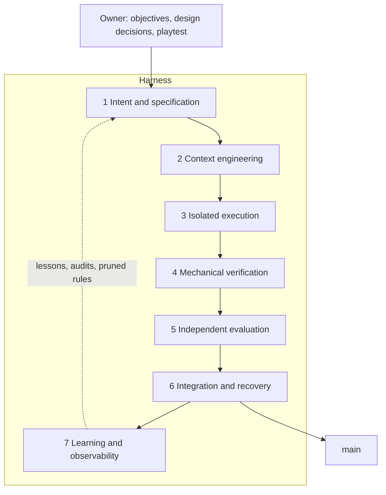
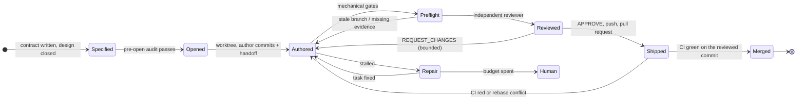

# The Sterium Harness: a reference architecture for agentic software delivery

> **In short:** one architecture, two control planes. It merges the unattended pipeline in this
> repository with the supervised parallel workflow that replaced it in day-to-day use, and adds
> the practices worth adopting from published harnesses (NVIDIA, Anthropic, OpenAI). Every
> component below says where it is implemented, so nothing here is aspirational without being
> labelled as such. To run it yourself, read [SETUP.md](SETUP.md).

## 1. What a harness is, and why this one exists

A coding model produces text. A *harness* is everything around the model that turns that text
into merged, trustworthy software: the instructions it starts from, the tools and files it may
touch, the checks its output must pass, the second opinion it cannot argue with, and the record
of what happened. The model is replaceable; the harness is where delivery quality is decided.

This harness was built in two generations on one real project, a deterministic colony
simulation in Godot ([sterium-ai/deepholm](https://github.com/sterium-ai/deepholm)):

| Generation | Control plane | Shape | Measured |
| --- | --- | --- | --- |
| 1. Unattended | A PowerShell supervisor driving a GitHub label state machine (this repository) | One task at a time, no person in the loop, three providers across five roles | 124 pipeline-merged pull requests in 13 days ([case study](../case-study.md)) |
| 2. Supervised parallel | [Orca](https://orca.dev) worktrees driven from its CLI, with an orchestrating session acting as the owner's interface | Up to three tasks in parallel, a person reachable for design decisions | 63 pull requests merged between 19 October and 12 November 2026; 33 of them in the first week (49 hours of running time) |

Generation 1 proved that unattended delivery can be made safe. Generation 2 proved that
parallelism and a short path to a human decision are worth more than full autonomy once the
codebase is large. The architecture below keeps what each generation got right.

## 2. Design principles

1. **Contracts over trust.** A task states the files it may change and the commands that prove
   it is done. An author's claim of a green run is never the evidence; the harness reruns it.
2. **No self-review.** The reviewer is a different provider from the author, runs read-only,
   and answers in a fixed verdict format. Only the exact commit it approved may merge.
3. **Mechanical before paid.** Anything a script can decide (scope, size budgets, test counts,
   a stale branch) is decided by a script before a model is asked to judge it.
4. **The repository is the system of record.** Briefs, decisions, handoff reports and review
   rules live in versioned files. A reviewer sees the repository, not the author's terminal;
   what is not written down does not exist.
5. **Least privilege, isolated work.** One worktree per task; authors cannot push or merge;
   reviewers cannot write.
6. **Context is a budget.** Cost grows with turns multiplied by context size, not with task
   difficulty. Briefs are scoped, context is compacted early, and tasks have a size ceiling.
7. **Fail towards a person, bounded.** Stalls go through a fixed repair ladder with a spend
   limit, then to a human with a plain-language explanation. Nothing loops silently.
8. **Never weaken verification.** Disabling a test, skipping a check or raising a budget to
   make a gate pass is itself a defect, whoever proposes it.
9. **Every harness component is a hypothesis.** Each one exists because a model could not be
   trusted to do something alone. Those assumptions are re-tested when models change, and
   components that no longer carry load are removed.

## 3. The seven layers

Status key: **Gen 1** = implemented in this repository · **Gen 2** = implemented in
`sterium-ai/deepholm` (`tools/orca/`, `docs/orca/`, `.claude/settings.json`) · **Operated** =
done by the orchestrating session following a written rule, not yet a script · **Adopted
pattern** = taken from another harness and recommended, not yet implemented here.

### Layer 1: Intent and specification

| Component | What it does | Status |
| --- | --- | --- |
| Objective intake | The owner states a result in plain language; the orchestrator asks at most three to five questions whose answers change the plan, never about implementation | Gen 1 ([HOW_TO_GIVE_OBJECTIVES.md](../HOW_TO_GIVE_OBJECTIVES.md)), Gen 2 (operated) |
| Task contract | Each task carries **Goal, Owned paths, Acceptance, Non-goals**; feature tasks also carry a **Design** block the owner has closed | Gen 1 (issue header, `scripts/lib/task-preflight.ps1`), Gen 2 (`BACKLOG.md` entry; `new-task.ps1` refuses a task whose design is pending) |
| Pre-open audit | Before a task starts: do the named files exist, is the acceptance measurable on today's `main`, does it collide with work in flight | Gen 1 (preflight), Gen 2 (operated; five early tasks stalled on stale entries before this rule) |
| Assumption register | Seven classes of assumption that made tasks fail (behaviour assumed to exist, ownership assumed narrow, atomic changes assumed splittable, and others), checked against every new task | Gen 1 and Gen 2 (written rule; see section 7) |
| Negotiated sprint contract | Author proposes scope and proof, evaluator agrees before work starts | Adopted pattern (Anthropic); here the contract is fixed by the planner or owner instead |

### Layer 2: Context engineering

| Component | What it does | Status |
| --- | --- | --- |
| `AGENTS.md` as a map | A short rule book every agent reads first, pointing to deeper documents on demand | Gen 1 (`docs/examples/target-project-AGENTS.md`), Gen 2 |
| Brief in the prompt | The task's own entry travels inside the launch prompt; the agent is told not to load the whole backlog | Gen 2 (`new-task.ps1`) |
| Early compaction | Context is compacted at 120k tokens instead of at exhaustion | Gen 2 (`autoCompactWindow` in `.claude/settings.json`) |
| Task size ceiling | About 300 turns or four hours; anything larger is split before it is opened | Gen 2 (rule plus prompt reminder) |
| Model tiering | A cheaper model for mechanical sweeps, hygiene and documentation; the strongest model only for design and core changes | Gen 2 (`new-task.ps1 -Model`) |
| Delegated exploration | Sub-agents search and read, returning a summary; long files and full test output never enter the main context | Gen 2 (rule in the launch prompt) |
| Skills | Recurring procedures (review, ship, handoff) packaged as on-demand `SKILL.md` folders rather than standing prompt text | Adopted pattern (NVIDIA agent skills, agentskills.io); here they are scripts and documents |

### Layer 3: Isolated execution

| Component | What it does | Status |
| --- | --- | --- |
| Worktree per task | One branch, one directory, one author; parallel tasks cannot see each other's edits | Gen 1 (`Invoke-Implementation`), Gen 2 (Orca worktrees) |
| Author permissions | Edits and a fixed allowlist of commands; `git push`, `git reset --hard` and `gh pr merge` are denied | Gen 1 (`scripts/run-agent.ps1` tool policy), Gen 2 (`.claude/settings.json`) |
| Read-only reviewer | The reviewer runs in a sandbox that forbids writes | Gen 1, Gen 2 (`codex exec --sandbox read-only`) |
| Concurrency limits | At most three authors, one full test suite at a time (a named global mutex in the test runner), at most two reviews in parallel | Gen 2 (`tools/run_tests.ps1`; limits set after four simultaneous suites exhausted a 31 GB host) |
| Protected user data | No script, test, benchmark or profiler may touch real user data; anything that boots the product redirects storage first and asserts it | Gen 2 (review rule, blocking; added after a profiling task overwrote local save files) |
| Out-of-process policy | Filesystem, process and network rules enforced below the agent, credentials injected only for approved endpoints and never visible to the agent, risky policy changes held for human review | Adopted pattern (NVIDIA OpenShell). Today enforcement is in-process, by each CLI's own permission system; see section 8 |

### Layer 4: Mechanical verification

| Component | What it does | Status |
| --- | --- | --- |
| Structural gates | Size budgets per file and function, content lints, a compiler-warning baseline; a raised budget needs a decision record | Gen 2 (`tools/check_core_budgets.py` and CI) |
| Host-run acceptance | The harness runs the task's acceptance commands itself, with a timeout, a denylist and a trusted-author allowlist | Gen 1 (`Invoke-AcceptanceCommands`) |
| Review preflight | The reviewer is not launched if the branch is behind `main` in code, or the handoff does not quote the test runner's final line for the current test count | Gen 2 (`review.ps1`; a third of first-week review rounds were exactly these two findings) |
| Continuous integration | The full headless suite on every pull request; documentation-only changes skip it | Gen 2 (GitHub Actions, `paths-ignore`) |
| End-to-end evidence | Behaviour is proven through the real trigger (a command, an incident, a save and load), not a direct call to an internal function | Gen 2 (review rule), matching Anthropic's end-to-end testing guidance |

### Layer 5: Independent evaluation

| Component | What it does | Status |
| --- | --- | --- |
| Cross-provider review | Author and reviewer come from different vendors | Gen 1 (`Get-EffectiveReviewer`), Gen 2 (Claude Code authors, Codex reviews) |
| Review script | One document lists what is always checked and what is checked per task type; the author reads it before handing off | Gen 1 (`docs/agent-prompts/reviewer.md`), Gen 2 (`docs/orca/REVIEW.md`) |
| Fixed verdict format | `VERDICT: APPROVE` or `REQUEST_CHANGES`, blocking and non-blocking findings with file and line, and a checklist of what was verified | Gen 1, Gen 2 |
| Exact-commit merge | Only the reviewed commit may merge; a rebase triggers re-review | Gen 1 (`headRefOid` check), Gen 2 (operated: rebase, CI, then merge) |
| Effort tiering | Higher reviewer reasoning effort for core, scheduler and persistence changes | Gen 2 (`review.ps1 -Effort high`) |
| Same-vendor fallback | A fresh session of the author's vendor reviews only when the other provider has no quota, and is recorded as less independent | Gen 1 (stand-in provider), Gen 2 (`review.ps1 -Agent claude`) |

### Layer 6: Integration and recovery

| Component | What it does | Status |
| --- | --- | --- |
| Serialized integration | Core merges go one at a time; every pull request is rebased on current `main` and CI reruns before merge; a conflicted rebase is handed back to the task's author | Gen 1, Gen 2 (host script plus rule) |
| Squash merge, one task one PR | History reads as one reviewed task per commit | Gen 1, Gen 2 |
| Repair ladder | Hint, patch the task text, rescope, add a capability rule, rewrite, switch author; at most two repairs, then one bounded expert session, then a person | Gen 1 (`Invoke-Repair`, `scripts/lib/expert-recovery.ps1`); Gen 2 (operated by the orchestrating session) |
| Crash recovery | Exclusive lock, launch-intent records, salvage of interrupted work | Gen 1; Gen 2 resumes agent sessions by id and requires a work-in-progress commit plus handoff note before any shutdown |
| Quota handling | A provider out of quota is paused until its stated reset; reserve logins rotate; another provider stands in | Gen 1 (`Register-QuotaBlock`) |
| Human checkpoints | Owner playtest every two or three user-visible merges; findings become new tasks with reproduction steps | Gen 2 (operated) |

### Layer 7: Learning and observability

| Component | What it does | Status |
| --- | --- | --- |
| Lessons loop | A finding reviewers raise twice becomes a rule injected into later prompts, mechanically checked where possible; task-specific narratives are filtered out | Gen 1 (`scripts/lessons.ps1`) |
| Handoff reports | Each task leaves a report in the repository: what moved, the runner's final line, measurements, reproducible verification commands | Gen 2 (`docs/orca/handoffs/`) |
| Session-trace audits | Cost and turn analysis from the agents' own local transcripts | Gen 2 (two written audits; see section 6) |
| Owner dashboard | Queue, provider quotas, sessions, tokens, live step | Gen 1 (`docs/dashboard/`) |
| Trace export | Spans closed at session boundaries and exported for audit and optimisation | Adopted pattern (NVIDIA NeMo Relay); here audits are run on demand, not continuously |
| Entropy collection | Background agents that scan for drift from stated principles and open small refactoring pull requests | Adopted pattern (OpenAI); here drift is caught by budgets and filed as tasks |
| Harness pruning | Components re-tested and removed when a new model no longer needs them | Operated; Generation 2 dropped the planner, the label state machine and the scheduled supervisor |

## 4. Roles

| Role | Who | May | May not |
| --- | --- | --- | --- |
| Owner | A person | Set objectives, decide product rules, sign decision records, test the result | Be asked about implementation detail |
| Orchestrator | The supervisor script (Gen 1) or an orchestrating model session acting as the owner's interface (Gen 2) | Open tasks, run gates, launch reviews, rebase, merge, grant recorded scope clarifications | Edit task code, resolve an author's merge conflict, bypass a gate |
| Planner | A read-only model session (Gen 1) | Split an objective into task contracts | Write code |
| Author | A model session in its own worktree | Edit owned paths, run tests, commit, write the handoff | Push, merge, touch files outside the contract, weaken a check |
| Reviewer | A different provider, read-only | Read the diff, the contract and the handoff; return a verdict | Edit anything |
| Repairer and expert | Bounded model sessions (Gen 1) | Change the task, not the gate | Exceed the repair budget |
| CI | GitHub Actions | Decide whether the suite passes | Be skipped for code changes |

## 5. Task lifecycle

Under the Generation 1 control plane these states are GitHub labels moved by the supervisor.
Under Generation 2 they are a status row in the backlog plus the worktree's state, moved by
`new-task.ps1`, `review.ps1` and `ship.ps1`.

## 6. What the measurements changed

- **A third of first-week review rounds were avoidable.** They said "rebase and update the test
  count". The review preflight now refuses to launch a reviewer in that state.
- **Three quarters of author cost was re-reading context.** Across 52 tasks and about 18,500
  turns, the average turn carried 226k tokens of accumulated context while producing under a
  thousand tokens of output. Seven changes followed: compaction at 120k, the task size ceiling,
  the brief in the prompt, model tiering, delegated exploration, a preflight that ignores
  documentation-only commits, and a slower supervision cadence (45 minutes mid-task, 20 minutes
  only while a review or CI run is in flight).
- **Review is cheap; skipping it is not.** Independent review was under three percent of total
  cost.
- **Parallelism is bounded by the host, not the model.** Four simultaneous test suites took the
  machine down; the mutex and the three-agent cap followed.
- **Structure held under load.** The project's largest file went from 4,994 to 767 lines over
  the refactoring tasks with save output and state hashes unchanged, which is the kind of change
  that is only safe when every step is independently verified.

## 7. The assumption register

Every failed task so far traced back to one of seven assumptions in its own text. Each new task
is read against this list before it is opened.

1. **Behaviour assumed to exist.** Open the module and confirm it does exactly that; otherwise
   it is a prerequisite task.
2. **Contract assumed.** Look up every term in the architecture documents and decision records;
   quote the contract's word, not a paraphrase.
3. **Ownership assumed narrow.** List every file the change will foreseeably touch, including
   persistence, schemas, viewers and the tests that assert on them.
4. **Numbers, paths and formats assumed from memory.** Measure them.
5. **Composition assumed.** Acceptance names the real end-to-end trigger and the test goes
   through it.
6. **Pipeline side effects assumed neutral.** When a finding concerns a file the author never
   edited, the cause is the harness; fix it once there.
7. **Atomic changes assumed splittable.** An identifier and everything that validates, persists
   or migrates it land in one task.

## 8. Security posture and known gaps

- **Enforcement is in-process.** Author permissions and the reviewer's read-only sandbox are
  enforced by the vendor CLIs. Launching an agent with a permission-bypass flag trades that
  enforcement for uninterrupted runs and belongs only on an isolated host.
- **Acceptance commands and tests execute on the host** with the operator's account. See the
  [security model](../../README.md#security-model): trusted authors only, a dedicated low-privilege
  token, a machine without personal credentials.
- **The recommended hardening** is a runtime that enforces policy outside the agent process:
  per-task filesystem, process and network rules, with credentials held outside the sandbox.
  NVIDIA OpenShell is the published design closest to this; it targets Linux, macOS and WSL 2,
  while both control planes here are Windows-native. It is not part of the tested configuration.
- **Text is input.** Objectives, task entries, review comments and anything an agent reads from
  the repository or the web are untrusted instructions from whoever wrote them.

## 9. What was taken from other harnesses

| Source | Idea | Here |
| --- | --- | --- |
| NVIDIA NemoClaw | The harness, models, tools and runtime shipped as one versioned blueprint | `agent-orchestrator.example.json` plus the repository-level settings and scripts are the blueprint; one file per target project |
| NVIDIA OpenShell | Policy enforced below the agent; credentials never visible to it; risky policy changes wait for a person | Adopted as the hardening target (section 8) |
| NVIDIA agent skills | Procedures as on-demand `SKILL.md` folders | Adopted pattern; procedures are scripts and short documents today |
| NVIDIA NeMo Relay | Traces closed at session boundaries and exported | Audits from local transcripts, on demand |
| Anthropic, long-running agents | A fixed session-start routine, one unit of work per session, a progress file, every session ends in a mergeable state, tests are never edited to pass | Launch prompt, handoff reports, the one-task-one-PR rule, principle 8 |
| Anthropic, harness design | Separate evaluator tuned to scepticism; file-based handoffs; remove components as models improve | Cross-provider review, handoff files, principle 9 |
| OpenAI, harness engineering | Short `AGENTS.md` as a map; repository as system of record; architecture enforced by linters whose messages explain the fix; background entropy collection | `AGENTS.md`, decision records, size budgets and lints; entropy collection not yet automated |

Where this harness differs from all three: review is always performed by a **different vendor's
model**, and merging is bound to **the exact commit that was reviewed and tested on the host**.

## 10. Roadmap

1. Bring Generation 1's automation (repair ladder, lessons loop, quota failover, dashboard) to
   the parallel control plane, with a conflict-aware scheduler over owned paths.
2. A container or sandbox per acceptance run, then per author.
3. Continuous trace export instead of periodic audits.
4. Recurring procedures as skills, loaded on demand.
5. A scheduled entropy-collection task that opens small refactoring pull requests.

## Sources

- NVIDIA: [Agent harnesses](https://docs.nvidia.com/vss/vision-agent/agent-harnesses),
  [Build specialized agents with NemoClaw](https://developer.nvidia.com/blog/build-specialized-agents-on-a-stack-you-control-with-nvidia-nemoclaw),
  [OpenShell](https://github.com/NVIDIA/OpenShell)
- Anthropic: [Effective harnesses for long-running agents](https://www.anthropic.com/engineering/effective-harnesses-for-long-running-agents),
  [Harness design for long-running application development](https://www.anthropic.com/engineering/harness-design-long-running-apps)
- OpenAI: [Harness engineering](https://openai.com/index/harness-engineering/)
- Orca: [CLI overview](https://orca.dev/docs/cli/overview)
